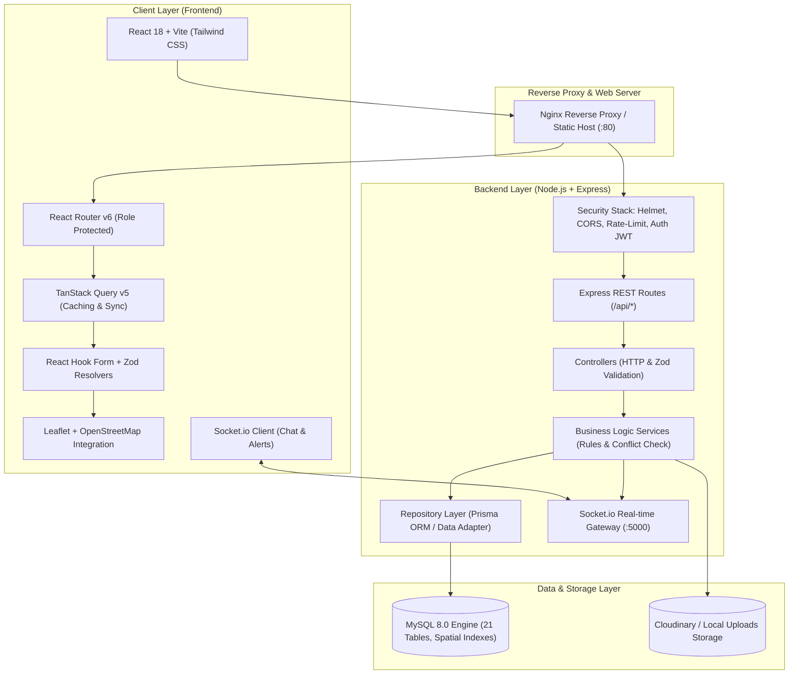
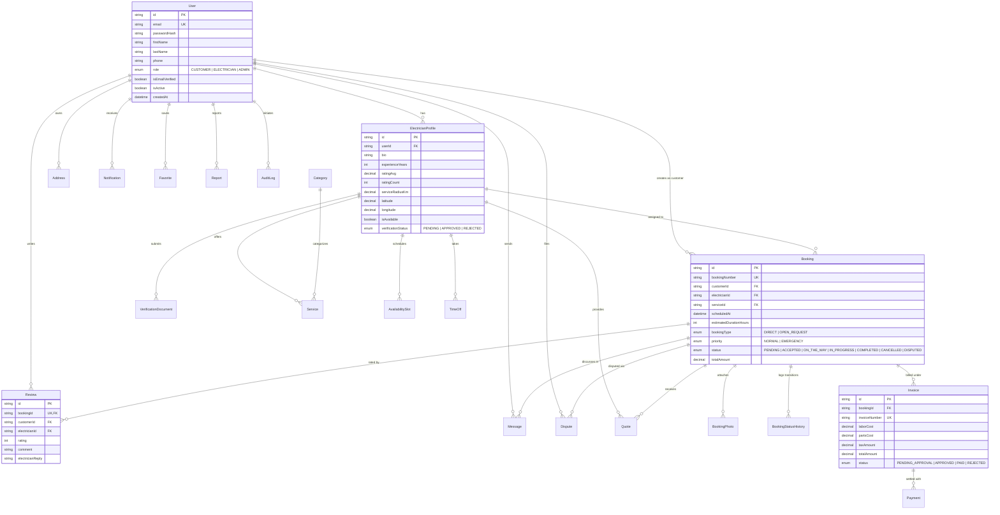

# ⚡ VoltFix — Local Electrician Marketplace

[](https://github.com/voltfix/voltfix/actions)
[](https://opensource.org/licenses/MIT)
[](https://nodejs.org)
[](https://react.dev)
[](https://www.typescriptlang.org)
[](https://www.prisma.io)
[](http://localhost:5000/api/docs)

> **VoltFix** is a full-stack, enterprise-grade local service marketplace that connects homeowners and businesses with verified, background-checked electricians. VoltFix features real-time geospatial search, interactive Leaflet mapping, conflict-free transactional booking, live Socket.io messaging, milestone-based invoicing, dispute mediation, and role-based administration.

---

## 📋 Table of Contents
1. [Problem Statement](#-problem-statement)
2. [System Architecture](#-system-architecture)
3. [Database Schema & ER Diagram](#-database-schema--er-diagram)
4. [Roles & Permissions](#-roles--permissions)
5. [Key Functional Highlights](#-key-functional-highlights)
6. [API Specification](#-api-specification)
7. [Real-Time Socket.io Gateway](#-real-time-socketio-gateway)
8. [Seed Test Accounts](#-seed-test-accounts)
9. [UI & Screenshots Walkthrough](#-ui--screenshots-walkthrough)
10. [Local Development & Setup](#-local-development--setup)
11. [Docker Deployment](#-docker-deployment)
12. [Testing & Quality Assurance](#-testing--quality-assurance)
13. [Security, Privacy & Performance](#-security-privacy--performance)

---

## 🎯 Problem Statement

Finding reliable, certified electricians in emergency and routine situations is plagued by:
- **Unverified Credentials:** Customers risk electrical hazards and code violations by hiring unvetted contractors without verified licenses or insurance.
- **Opaque Pricing & Hidden Surcharges:** Absence of upfront labor/parts estimates and binding quotes causes billing disputes.
- **Scheduling Conflicts & Ghosting:** Manual scheduling leads to overlapping bookings, delayed arrivals, and missed emergency windows.
- **Privacy Risks:** Customer contact numbers and home addresses are often leaked before a booking is confirmed or accepted.

**VoltFix solves these challenges** through an end-to-end digital marketplace featuring:
1. **Admin License Verification (`PENDING` ➔ `APPROVED` ➔ `REJECTED`)** before an electrician appears in search results.
2. **Geospatial Proximity Search (`ST_Distance_Sphere`)** with bounding-box prefiltering for sub-second lookups.
3. **Double-Booking Prevention** using atomic database transactions and interval overlap checks.
4. **Conditional Privacy Masking:** Exact street addresses and telephone numbers remain strictly hidden until the booking status advances to `ACCEPTED`.
5. **Itemized Digital Invoices:** Labor and parts breakdowns requiring explicit customer sign-off before payment execution.
6. **Per-Booking Real-Time Chat & Live Notifications:** Zero platform leakage with photo sharing, read receipts, and live socket alerts.

---

## 🏛️ System Architecture

VoltFix is built following strict separation of concerns, high modularity, and layered architectural boundaries:



### Layered Architecture Structure
- **Routes (`/src/routes`):** Declarative route definitions mapping URI endpoints and HTTP verbs to controller actions with authentication and role-guard middlewares.
- **Controllers (`/src/controllers`):** Request parsing, Zod schema validation, response formatting, and HTTP status code dispatch.
- **Services (`/src/services`):** Pure business logic, transactional lifecycle management, conflict checking, rating recalculations, and privacy filters.
- **Repositories (`/src/repositories`):** Normalized data access through Prisma ORM with spatial query execution and dual-mode data persistence.

---

## 🗄️ Database Schema & ER Diagram

The database is normalized across **21 relational tables** designed for MySQL 8:



---

## 👥 Roles & Permissions

| Role | Access Scope | Protected Actions |
|---|---|---|
| **`CUSTOMER`** | Consumer Portal | Browse verified electricians, create direct or open bookings, upload damage photos, approve invoices, real-time chat, review completed jobs, save favorites, submit disputes. |
| **`ELECTRICIAN`** | Professional Dashboard | Manage hourly rates & service catalog, set weekly schedules & time-off dates, toggle live availability, submit ID/trade licenses, accept/reject booking requests, advance dispatch status, submit labor+parts invoices, reply to reviews. |
| **`ADMIN`** | Platform Governance | Review and approve/reject electrician credentials, audit dispute evidence, manage service categories, inspect platform-wide audit logs, monitor platform revenue and booking metrics. |

---

## ⚡ Key Functional Highlights

### 1. Geospatial Electrician Discovery (`ST_Distance_Sphere`)
- **Bounding Box Pre-filtering:** Computes a minimum/maximum latitude and longitude bounding box based on the search center and radius in kilometers before computing exact spherical distance.
- **Accurate Distance Sorting:** Employs MySQL `ST_Distance_Sphere(POINT(lng, lat), POINT(e_lng, e_lat))` (with automatic Haversine mathematical fallback in offline mode) to yield distance in kilometers with zero query degradation.

### 2. Double-Booking Prevention & Status Lifecycle
- **Conflict Checking:** Before a booking is accepted or created, the system checks for any overlapping booking where `scheduledAt` falls within `(existing.scheduledAt - new.duration)` and `(existing.scheduledAt + existing.duration)` under active statuses (`PENDING`, `ACCEPTED`, `ON_THE_WAY`, `IN_PROGRESS`).
- **Atomic State Transitions:**
  $$\text{PENDING} \longrightarrow \text{ACCEPTED} \longrightarrow \text{ON\_THE\_WAY} \longrightarrow \text{IN\_PROGRESS} \longrightarrow \text{COMPLETED}$$
  *(With branch states: `CANCELLED` and `DISPUTED`)*.
- **Audited History:** Every transition generates a persistent `BookingStatusHistory` record with actor ID, source status, destination status, timestamp, and optional reason.

### 3. Conditional Privacy Safeguard
- In compliance with privacy standards, a customer's specific street address, apartment unit, and telephone number are completely masked (`***-***-XXXX` and `Area visible upon booking acceptance`) until the electrician officially accepts the booking.

### 4. Interactive 4-Step Booking Wizard
1. **Service Selection:** Choose from category-filtered services (inspection, hourly wiring, emergency breaker fix) with transparent pricing.
2. **Problem Details & Photos:** Detailed problem notes with multi-photo upload support.
3. **Location & Interactive Map Pin Drop:** Select saved address or drop an interactive pin on the map to set exact coordinates, with one-click "Use My GPS" assistance.
4. **Schedule & Priority:** Select scheduled date/time slot, toggle **Normal** vs. **⚡ 24/7 Emergency Dispatch**, review total breakdown, and confirm.

### 5. Dual-Engine Interactive Mapping (Google Maps & OpenStreetMap)
- **Zero-Config OpenStreetMap / Leaflet:** Fully operational out-of-the-box with free OpenStreetMap tiles, zero API key requirements, and zero usage limits.
- **Official Google Maps Platform Integration:** Includes dark-mode styled vector tiles, radius circles, custom glowing electrician markers, and booking InfoWindows using `@googlemaps/js-api-loader`.
- **In-App Provider Switcher & Key Manager:** Seamlessly switch between Google Maps and OpenStreetMap via the floating header badge on the map, with an in-app dialog to paste and test your Google Cloud API Key on the fly.

### 6. Bilingual Localization (English & বাংলা)
- **Native Internationalization:** Instant language switching between **English (EN)** and **বাংলা (BN)** across the platform without page reload.
- **Universal Language Switcher:** Available in the sticky Navbar, mobile drawer menu, and platform footer.
- **Localized Workflows:** Fully localized Search & Map filters, service categories, technician cards, urgent 24/7 emergency dispatch, and the 4-step Booking Wizard.
- **Persistent Preferences:** User language choice is automatically remembered in `localStorage` and updates the document `lang` attribute.

### 7. Dual Themes (Dark & Light Mode)
- **1-Click Theme Toggle:** Seamless switching between **Dark** and **Light** themes via the Sun/Moon toggle button in the Navbar, Mobile Drawer, and Footer.
- **Class-Based Tailwind CSS:** Instant reactivity using the `dark` class strategy on `document.documentElement` without layout shifts or reloading.
- **Persistent Choice:** Automatically remembers your preferred theme in `localStorage` and honors system `prefers-color-scheme`.
- **Refined Aesthetics:** Dark mode provides high-contrast neon volt accents over deep slate surfaces, while Light mode delivers clean, crisp typography with elegant glassmorphism.

---

## 📡 API Specification

Interactive Swagger / OpenAPI 3.0 documentation is available at `http://localhost:5000/api/docs`.

### Authentication (`/api/auth`)
| Method | Endpoint | Description | Auth Required |
|---|---|---|---|
| `POST` | `/api/auth/register` | Register new customer or electrician account | No |
| `POST` | `/api/auth/login` | Authenticate with email/password; returns access token + httpOnly refresh cookie | No |
| `POST` | `/api/auth/refresh-token` | Exchange refresh token for fresh access token | Cookie |
| `POST` | `/api/auth/logout` | Invalidate current refresh token and clear cookie | Cookie |
| `GET` | `/api/auth/me` | Fetch currently authenticated user profile | Bearer |
| `POST` | `/api/auth/forgot-password` | Request password reset token | No |
| `POST` | `/api/auth/reset-password` | Reset password using verified token | No |

### Search & Profiles (`/api/electricians`, `/api/search`)
| Method | Endpoint | Description | Auth Required |
|---|---|---|---|
| `GET` | `/api/search` | Search electricians with geo-radius, category, rating, price, and sorting | No |
| `GET` | `/api/electricians/:id` | Fetch electrician public profile, portfolio, services, and reviews | No |
| `PUT` | `/api/electricians/profile` | Update electrician profile bio, radius, coordinates, experience | Electrician |
| `POST` | `/api/electricians/services` | Add or update offered service with fixed/hourly rate | Electrician |
| `PUT` | `/api/electricians/availability` | Update weekly recurring time-slots | Electrician |
| `POST` | `/api/electricians/toggle-online` | Toggle electrician availability online/offline | Electrician |
| `POST` | `/api/electricians/documents` | Upload trade certification or photo ID for admin review | Electrician |

### Bookings & Lifecycle (`/api/bookings`)
| Method | Endpoint | Description | Auth Required |
|---|---|---|---|
| `POST` | `/api/bookings` | Create direct booking or open request with conflict checks | Customer |
| `GET` | `/api/bookings` | List user's bookings (filtered by role and status) | Customer / Pro |
| `GET` | `/api/bookings/:id` | Get booking detail with privacy masking if not accepted | Authenticated |
| `PATCH` | `/api/bookings/:id/status` | Advance status (`ACCEPTED`, `ON_THE_WAY`, `COMPLETED`, etc.) | Pro / Customer |
| `POST` | `/api/bookings/:id/cancel` | Cancel booking according to cancellation policy | Authenticated |
| `POST` | `/api/bookings/:id/reschedule` | Reschedule booking to a new conflict-free time slot | Authenticated |

### Invoices & Billing (`/api/invoices`)
| Method | Endpoint | Description | Auth Required |
|---|---|---|---|
| `POST` | `/api/invoices` | Electrician creates itemized invoice (labor + parts + tax) | Electrician |
| `GET` | `/api/invoices/:id` | Fetch invoice details for a booking | Authenticated |
| `PATCH` | `/api/invoices/:id/approve` | Customer approves invoice for settlement | Customer |

### Real-Time Chat (`/api/chat`)
| Method | Endpoint | Description | Auth Required |
|---|---|---|---|
| `GET` | `/api/chat/:bookingId/messages`| Fetch chat history for an authorized booking | Authenticated |
| `POST` | `/api/chat/:bookingId/messages`| Send text message or photo attachment | Authenticated |
| `POST` | `/api/chat/:bookingId/read` | Mark all unread messages as read | Authenticated |

### Reviews & Ratings (`/api/reviews`)
| Method | Endpoint | Description | Auth Required |
|---|---|---|---|
| `POST` | `/api/reviews` | Submit rating (1-5) and comment strictly after `COMPLETED` | Customer |
| `GET` | `/api/reviews/electrician/:id` | List verified reviews for an electrician | No |
| `POST` | `/api/reviews/:id/reply` | Electrician submits public reply to customer review | Electrician |

### Admin Governance (`/api/admin`)
| Method | Endpoint | Description | Auth Required |
|---|---|---|---|
| `GET` | `/api/admin/metrics` | Retrieve platform KPIs (revenue, users, booking velocity) | Admin |
| `GET` | `/api/admin/verifications` | List pending electrician trade certifications | Admin |
| `PATCH` | `/api/admin/verifications/:id`| Approve or reject electrician certification | Admin |
| `GET` | `/api/admin/users` | List and search registered users with ban/activate toggle | Admin |
| `GET` | `/api/admin/audit-logs` | Query chronological platform audit trail | Admin |

---

## 🔌 Real-Time Socket.io Gateway

VoltFix exposes a bidirectional Socket.io gateway on port `5000`:

| Event Channel | Payload | Description |
|---|---|---|
| `join_booking` | `{ bookingId }` | Authenticated client joins room for specific booking |
| `leave_booking`| `{ bookingId }` | Leaves chat room |
| `send_message` | `{ bookingId, message, senderId }` | Broadcasts new message to chat participants |
| `typing` | `{ bookingId, isTyping, userName }` | Real-time typing indicators |
| `message_read` | `{ bookingId, messageIds }` | Emits read receipts |
| `notification` | `{ userId, title, body, type }` | Real-time pop-up notification pushed to client |

---

## 🔑 Seed Test Accounts

The platform includes pre-seeded accounts for each user role with password: `Password123!`

| Role | Name | Email | Password | Details |
|---|---|---|---|---|
| **Admin** | Super Admin | `admin@voltfix.com` | `Password123!` | Full governance access, verification queues, disputes, metrics |
| **Electrician** | David Miller (Master) | `pro1@voltfix.com` | `Password123!` | Verified, 4.9★, 15 yrs exp, Residential & EV Specialist |
| **Electrician** | Sarah Jenkins (Commercial)| `pro2@voltfix.com` | `Password123!` | Verified, 4.8★, 12 yrs exp, Industrial Wiring |
| **Electrician** | Alex Rivera (Emergency) | `pro3@voltfix.com` | `Password123!` | Verified, 5.0★, 8 yrs exp, 24/7 Rapid Dispatch |
| **Customer** | Michael Smith | `customer1@voltfix.com` | `Password123!` | Has active `IN_PROGRESS` and `COMPLETED` bookings |
| **Customer** | Emily Johnson | `customer2@voltfix.com` | `Password123!` | Has pre-seeded quotes, invoices, and favorites |

> 💡 **Quick Login Buttons:** On the frontend login page (`/login`), click **"Admin Login"**, **"Electrician Login"**, or **"Customer Login"** to autofill credentials and authenticate with one click.

---

## 🖥️ UI & Screenshots Walkthrough

1. **Homepage & Emergency Hero Banner:**
   - Features rapid search by zip code/city, service category tiles, and an instant **"Need an Emergency Electrician?"** rapid dispatch button.
2. **Geospatial Search & Interactive Leaflet Map:**
   - Visualizes verified electricians with custom electric pin markers and dynamic radius circles. Includes sidebar filters for distance, ratings, price brackets, and emergency availability.
3. **Electrician Profile & Credentials Verification Badge:**
   - Displays master credentials, license numbers, hourly rates, verified customer reviews, portfolio gallery, and weekly availability slots.
4. **4-Step Booking Wizard:**
   - Guided flow preventing user drop-off: Step 1 (Service Selection), Step 2 (Problem Details & Photos), Step 3 (Address & Map Pin), Step 4 (Time Slot & Emergency Dispatch).
5. **Real-Time Per-Booking Chat Drawer:**
   - Slide-over live messaging panel supporting photo sharing, live typing indicators, and read receipts.
6. **Electrician Operations Dashboard:**
   - Real-time schedule calendar, incoming job requests, today's route dispatch, and earnings metrics.
7. **Customer Hub:**
   - Booking timeline tracking, quote comparison, invoice approval modal, and post-service review modal with star ratings.
8. **Admin Control Panel:**
   - Document verification queue with image zoom, user account moderation, dispute arbitration, and platform audit logs.

---

## 🚀 Local Development & Setup

### Prerequisites
- Node.js >= 20.0.0
- npm >= 10.0.0
- (Optional) MySQL 8.0 (VoltFix includes a persistent dual-mode adapter that functions out of the box even without an active local MySQL instance)

### 1. Clone & Install Dependencies
```bash
# Clone the repository
git clone https://github.com/voltfix/voltfix.git
cd VoltFix

# Install all workspace dependencies (root, backend, frontend)
npm install
```

### 2. Configure Environment Variables
```bash
# Backend configuration
cp backend/.env.example backend/.env

# Root docker configuration
cp .env.example .env
```

### 3. Initialize Database (Prisma)
```bash
cd backend

# Generate Prisma client
npx prisma generate

# (Optional with MySQL) Push schema & seed
# npx prisma db push
# npx prisma db seed

cd ..
```

### 4. Start Development Servers
From the root directory, launch both backend and frontend concurrently:
```bash
npm run dev
```

- **Backend API:** `http://localhost:5000`
- **Frontend Web:** `http://localhost:5173`
- **Swagger Documentation:** `http://localhost:5000/api/docs`
- **Health Check:** `http://localhost:5000/api/health`

---

## 🐳 Docker Deployment

VoltFix includes a production-ready `docker-compose.yml` that configures:
- `mysql:8.0` database with persistent volume and health checks
- `api` multi-stage Node 20 production container
- `web` multi-stage Vite build served via high-performance Nginx reverse proxy

```bash
# Build and run all services in detached mode
docker compose up --build -d

# Check running containers
docker compose ps

# View service logs
docker compose logs -f api
```

Services will be accessible at:
- **Web Application:** `http://localhost:80`
- **Backend API:** `http://localhost:5000`
- **MySQL Database:** `localhost:3306`

---

## 🧪 Testing & Quality Assurance

VoltFix includes comprehensive automated test suites using **Jest** and **Supertest** covering authentication, double-booking prevention, and review validation:

```bash
# Run backend test suites
cd backend
npm test
```

### Test Coverage Highlights:
- ✅ **Authentication:** Customer & Electrician registration, password hashing verification, JWT access & refresh token rotation, login rate limiting, protected route access denial.
- ✅ **Booking Lifecycle & Double-Booking Prevention:** Successful booking creation, interval overlap detection (rejecting double bookings on identical time slots), status progression (`PENDING` ➔ `ACCEPTED` ➔ `IN_PROGRESS` ➔ `COMPLETED`).
- ✅ **Reviews & Ratings:** Review submission rejection before `COMPLETED` status, review submission acceptance post-completion, automatic recalculation of electrician's average rating and total review count, prevention of duplicate reviews for the same booking.

---

## 🛡️ Security, Privacy & Performance

- **OWASP Compliance:** Configured with `helmet` for HTTP security headers, parameterized queries via Prisma ORM to prevent SQL injection, and strict input validation via Zod on every endpoint.
- **Rate Limiting:** Prevents brute-force authentication attacks using `express-rate-limit` (100 requests per 15-minute window for standard endpoints; 10 requests per 15-minute window for authentication endpoints).
- **Secure Token Rotation:** Refresh tokens are transported via `httpOnly`, `sameSite: 'lax'` secure cookies; access tokens expire every 15 minutes.
- **Privacy Masking:** Customer contact details are sealed behind role and status checks, mitigating off-platform circumvention and protecting personal information.
- **Structured Logging:** Centralized logging with `pino` providing machine-readable JSON logs for auditing and observability.

---

## 👨‍💻 Author

**Abu Bakar Rakib**  
- Email: [rakibcdp@gmail.com](mailto:rakibcdp@gmail.com)

---

## 📄 License
This project is licensed under the MIT License — see the [LICENSE](LICENSE) file for details.
